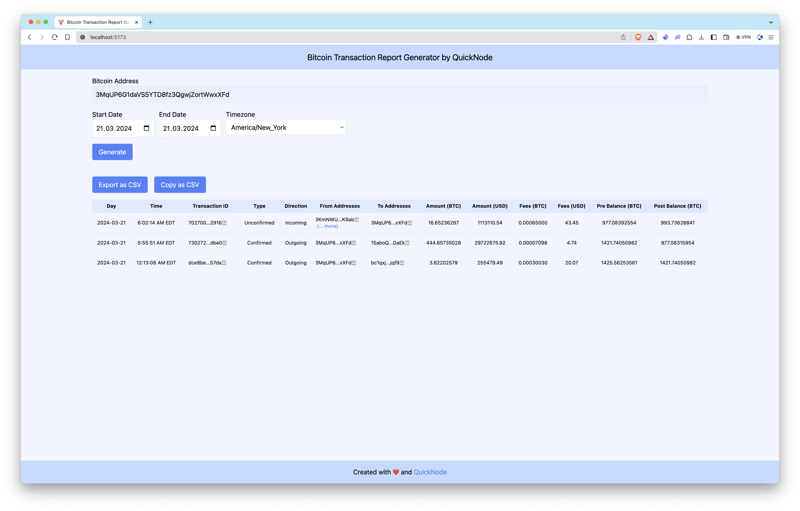

# Bitcoin Transaction Report Application

## Introduction

This application is designed to fetch and analyze Bitcoin transactions associated with a specific address using Quicknode's [Blockbook API](https://www.quicknode.com/blockbook?utm_source=internal&utm_campaign=sample-apps&utm_content=bitcoin-transaction-report-generator). It provides users with detailed reports within a specified date range, offering insights into transaction history, balances after each transaction, and the USD value of Bitcoin movements.

For an in-depth guide on how to fetch data and develop further functionalities, refer to [our comprehensive guide on Quicknode](https://www.quicknode.com/guides/quicknode-products/blockbook/how-to-generate-bitcoin-transaction-reports-with-blockbook) or [our script files](../../bitcoin/transaction-report-generator/).

### Tech Stack
- Frontend Framework/Library: React
- Language: TypeScript
- Build Tool/Development Server: Vite

## Features

- **Balance Calculation**: Calculates the BTC balance before and after each transaction.
- **Transaction Direction**: Identifies whether transactions are incoming or outgoing.
- **Confirmation Status**: Determines whether transactions are confirmed.
- **USD Conversion**: Computes the USD value of each transaction at the time it occurred.
- **Transaction Filtering**: Excludes internal wallet transactions that are not relevant to the address in question.
- **Date Range Filtering**: Generates reports for transactions within a specified date range.
- **Time Zone Selection**: Performs date filtering according to the selected timezone.
- **CSV Support**: Ability to export or copy result as CSV file.

## Getting Started

### Prerequisites

Before you begin, ensure you have the following:
- [Node.js](https://nodejs.org/en/) installed on your system.
- A Quicknode account with access to the [Blockbook API](https://www.quicknode.com/blockbook?utm_source=internal&utm_campaign=sample-apps&utm_content=bitcoin-transaction-report-generator).
    > Blockbook is a paid Quicknode product. Please check the details on the [Blockbook product page](https://www.quicknode.com/blockbook?utm_source=internal&utm_campaign=sample-apps&utm_content=bitcoin-transaction-report-generator) and compare plans based on your needs.
- A code editor or an IDE (e.g., [VS Code](https://code.visualstudio.com/))
- [Typescript](https://www.typescriptlang.org/) and [ts-node](https://typestrong.org/ts-node/)

> You can run the commands below to install TypeScript and ts-node globally to have TypeScript available across all projects.

```bash
npm install -g typescript
npm install -g ts-node
```

### Installation Dependencies

1. Clone the repository to your local machine:
```bash
git clone https://github.com/quiknode-labs/qn-guide-examples.git
```

2. Navigate to the project directory:
```bash
cd sample-dapps/bitcoin-transaction-report-generator
```

3. Install the necessary dependencies:
```bash
npm install
```

### Setting Environment Variables

Copy `.env.example` to `.env`. From your Blockbook-enabled Bitcoin mainnet endpoint, copy **Base URL** into `QUICKNODE_ENDPOINT_URL` and **Auth token** into `QUICKNODE_ENDPOINT_TOKEN`.

```env
QUICKNODE_ENDPOINT_URL=https://your-quicknode-endpoint.quiknode.pro/
QUICKNODE_ENDPOINT_TOKEN=your-auth-token
```

The browser calls `/api/blockbook` on the app's origin. The server route reads these variables and authenticates upstream. Set the same server variables in Vercel for deployment. For an existing install, move the full URL to the server variable and remove `VITE_QUICKNODE_ENDPOINT` from local and deployment settings. If you already have a full endpoint URL, you can set it as `QUICKNODE_ENDPOINT_URL` and leave `QUICKNODE_ENDPOINT_TOKEN` unset.

> [!NOTE]
> We recommend sending the **Auth token** in the `x-token` header for HTTPS requests. This reduces the risk of exposing credentials through URL logging and monitoring systems.
>
> Quicknode supports both header and URL-path authentication. Open **How to authenticate** on your endpoint overview to see the HTTPS examples. Keep the endpoint credentials in the server environment.

### Running the Application

Run the development server:

```bash
npm run dev
```

Open [http://localhost:5173/](http://localhost:5173/) with your browser to see the application.

## Using the App

1. Input a Bitcoin wallet address.
2. (Optional) Select date range and time zone.
3. Press `Generate`. 
4. (Optional) Export or copy results as CSV.

The **Bitcoin Transaction Report Generator** application will query the Bitcoin blockchain for the wallet's transactions, filter these transactions data and calculate additional variables. Lastly, the app display results.

## Preview 



## Conclusion

[Quicknode's Blockbook API](https://www.quicknode.com/blockbook?utm_source=internal&utm_campaign=sample-apps&utm_content=bitcoin-transaction-report-generator) facilitates the creation of detailed Bitcoin transaction reports for developers and businesses alike. While this application covers the fundamentals, there's a vast scope for customization and extended functionalities. Whether for audit purposes, regulatory compliance, or market analysis, Blockbook streamlines the process of extracting blockchain data.

To discover more about how Quicknode assists auditing firms and individuals in extracting this type of data from blockchains, please [contact us](https://www.quicknode.com/contact-us); we're eager to engage with you!


