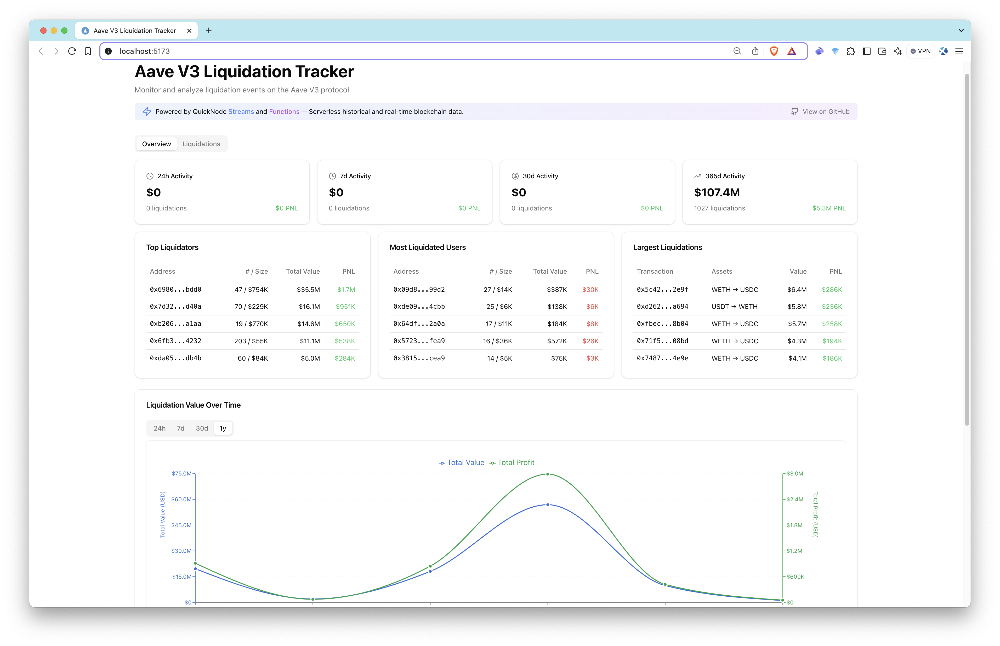
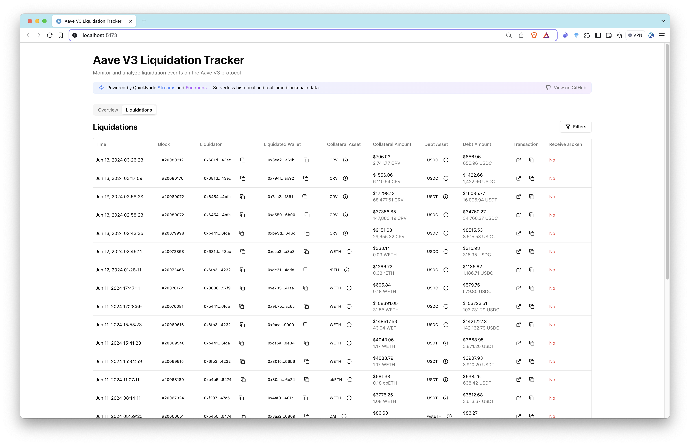

# Aave V3 Liquidation Tracker

Monitor and analyze liquidation events on the Aave V3 protocol in real-time. This project demonstrates the power of serverless blockchain data streaming using Quicknode's [Streams](https://www.quicknode.com/streams?utm_source=internal&utm_campaign=sample-apps&utm_content=aave-v3-liquidation-tracker).

| Dashboard Overview | Liquidations Table |
| --- | --- |
|  |  |

## Features

- 📊 Real-time liquidation monitoring
- 💰 Detailed metrics and analytics
- 📈 Historical liquidation trends
- 🔄 Asset distribution analysis
- ⚡ Serverless architecture

## Aave Pool Contract and LiquidationCall Event

### Aave V3 Pool Contract Overview
The **[Pool.sol](https://github.com/aave-dao/aave-v3-origin/blob/main/src/contracts/protocol/pool/Pool.sol)** contract (For Ethereum Mainnet, `0x87870Bca3F3fD6335C3F4ce8392D69350B4fA4E2`) in the Aave V3 protocol is the core of the lending and borrowing system. It facilitates deposits, borrowing, repayments, and liquidations.

### Event to Track: LiquidationCall
The **LiquidationCall** event is emitted when a liquidation occurs in the Aave protocol. It provides critical information about the liquidation transaction, including the collateral seized and the debt repaid.

```solidity

// Event Signature 
// 0xe413a321e8681d831f4dbccbca790d2952b56f977908e45be37335533e005286

LiquidationCall(
    address collateralAsset,
    address debtAsset,
    address user,
    uint256 debtToCover,
    uint256 liquidatedCollateralAmount,
    address liquidator,
    bool receiveAToken
)
```

#### Event Parameters
| **Parameter**            | **Type**   | **Description**                                             |
|--------------------------|------------|-------------------------------------------------------------|
| `collateralAsset`        | `address`  | The address of the asset being seized as collateral.         |
| `debtAsset`              | `address`  | The address of the asset that the liquidator is repaying.    |
| `user`                   | `address`  | The address of the borrower being liquidated.               |
| `debtToCover`            | `uint256`  | The amount of debt being repaid during the liquidation.      |
| `liquidatedCollateralAmount` | `uint256`  | The amount of collateral seized by the liquidator.          |
| `liquidator`             | `address`  | The address of the liquidator performing the liquidation.    |
| `receiveAToken`          | `bool`     | If `true`, liquidator receives aTokens instead of collateral.|

We will be using decoded logs of the `LiquidationCall` event to track liquidations on the Ethereum Mainnet.

## How It Works

This application uses a completely serverless architecture to track and analyze Aave V3 liquidation events:
1. **Data Collection**: **Streams** monitors the raw blockchain event data for Aave V3's liquidation events in both historical and real-time
2. **EVM Decoding**: **Streams** decode the raw event data using the [EVM Decoder](https://www.quicknode.com/docs/streams/filters#decoding-evm-data) to extract the relevant information
3. **Data Processing**: Using `viem` and webhooks, we temporarily listen to incoming data and process the decoded event data by fetching token prices and token details
4. **Data Storage**: Enriched event data is automatically stored in the PostgreSQL database
5. **Frontend Display**: React application fetches and displays the data with real-time updates

## Tech Stack

- **Frontend**
  - React
  - TypeScript
  - TanStack Query for data fetching
  - Tailwind CSS for styling
  - shadcn/ui for UI components
  - Recharts for data visualization

- **Backend**
  - Quicknode [Streams](https://www.quicknode.com/streams?utm_source=internal&utm_campaign=sample-apps) for historical and real-time blockchain data
  - [Supabase](https://supabase.com/) (PostgreSQL) for data storage

## Architecture

[Architecture Diagram](./images/architecture-chart.png)

The architecture demonstrates how the system leverages Quicknode's infrastructure to process blockchain data efficiently:

1. Quicknode Stream monitors Aave V3 contract events
2. Events are sent to a webhook server for processing
3. Data is enriched with token and price information
4. Processed data is stored in Supabase
5. Frontend fetches and displays real-time data

## Quicknode Integration

### Streams

Quicknode Streams provide real-time blockchain data without running a node:

- Monitors Aave V3 contracts for liquidation events
- Filters and delivers only relevant events
- Ensures reliable data delivery with retry mechanisms
- Streams manages blockchain data delivery; the webhook worker still needs hosting

### Webhooks

We are using a webhook server to: 

- Transforms blockchain data into application-ready format
- Enriches events with additional data
  - Fetching token metadata from blockchain (name, symbol, decimals) and storing them in Key-Value Store for future use
  - Real-time token prices from price feeds
  - Calculated USD values for all amounts
  - Historical price data for analytics
- Handles data validation and normalization
- Automatically stores processed data in the database

## Getting Started

### Prerequisites

- Node.js 22.12 or later and npm.
- A [Quicknode account](https://dashboard.quicknode.com/) with Streams and an Ethereum mainnet RPC endpoint. Historical price enrichment needs archive access for the replay block.
- A [Supabase project](https://supabase.com/) with its project URL, publishable key, and a separate backend secret key.
- [ngrok](https://ngrok.com/download) or another HTTPS tunnel for local webhook delivery.

### Installation

1. Clone the repository and install the locked dependencies:

```bash
git clone https://github.com/quiknode-labs/qn-guide-examples.git
cd qn-guide-examples/sample-dapps/ethereum-aave-liquidation-tracker
npm ci
cp .env.example .env
```

2. Fill in `.env` using your Quicknode endpoint and Supabase **Project Settings > API Keys**:

```dotenv
# Public browser configuration. Both clients point to the same Supabase project.
VITE_SUPABASE_URL=https://YOUR_PROJECT.supabase.co
VITE_SUPABASE_PUBLISHABLE_KEY=YOUR_SUPABASE_PUBLISHABLE_KEY

# Backend only. Never prefix this secret with VITE_.
SUPABASE_URL=https://YOUR_PROJECT.supabase.co
SUPABASE_SECRET_KEY=YOUR_SUPABASE_SECRET_KEY

# Full endpoint: https://your-endpoint.ethereum-mainnet.quiknode.pro/your-token/
QUICKNODE_RPC_URL=YOUR_ETHEREUM_MAINNET_RPC_ENDPOINT
PORT=3005
WEBHOOK_SECRET_KEY=REPLACE_WITH_YOUR_STREAM_SECURITY_TOKEN
```

The `VITE_` values are exposed in the browser. `SUPABASE_SECRET_KEY`, the RPC endpoint, and the Stream token stay on the server. Keep `.env` out of Git. The backend requires its own secret so the browser can read liquidation data without permission to write it.

3. For a new database, run `supabase/schema.sql` in the Supabase SQL Editor. It creates the event identity constraint and read-only public dashboard policy. Then run `supabase/analytics.sql` to install the three dashboard query functions shown below.

For an existing installation, pause the Stream and back up the table, then run `supabase/migration-event-identity.sql` instead of `schema.sql`. This adds columns without deleting old data and restricts public writes. Existing rows have a null log index and cannot be deduplicated retroactively from their transaction hash alone. Backfill their log identities from receipts before replaying old ranges if you need accurate totals across legacy data. Update the Stream filter and backend together before reactivating.

4. Check the application, then start the frontend:

```bash
npm test
npm run build
npm run dev
```

### Connect the Webhook and Stream

The frontend and webhook server are separate processes. Deploying the frontend to Vercel does not host the webhook worker. For a local test, create a paused Stream before starting the worker so its security token is available.

1. In the [Streams dashboard](https://dashboard.quicknode.com/streams), create an **Ethereum mainnet** Stream with **Blocks with Receipts**, batch size **1**, and **Modify payload** enabled. Start with block `18983377` and end block `18983378` for a bounded replay.
2. Paste the filtering code below and run the filter test at `18983377`. The filter processes all blocks in a batch, keeps each event's timestamp, and includes its transaction hash, log index, and block hash. Empty matches return `null`; broken input raises a visible error.
3. In another terminal, run `ngrok http 3005`. Choose **Webhook** as the Stream destination and append `/webhook` to the tunnel's HTTPS address.
4. Set compression to **None**, destination timeout to **30 seconds**, maximum failed retries to **3**, and retry interval to **3 seconds**. Save the Stream **paused**. Copy its destination **Security token** to `WEBHOOK_SECRET_KEY` in `.env`.
5. Start the backend in another terminal:

```bash
npm run server
```

The command loads `.env` before importing the RPC and security modules. Missing configuration stops startup. Verify `http://localhost:3005/health` and your tunnel's HTTPS `/health` endpoint, then activate the paused Stream.

Unsigned requests to `/webhook` return `401`. Signed malformed payloads return `400`; compressed requests return `415`. A processing or storage failure returns `503` so Streams can retry. Success returns `200` only after the batch is persisted. The database upserts by transaction hash and log index, keeping replays from adding duplicate events. Multiple liquidation logs from the same transaction remain separate rows.

The sample enriches each event before responding. Keep batch size one and use the short replay first. If processing repeatedly exceeds the delivery timeout, use a durable queue before acknowledging larger workloads. Changing the timeout alone does not make background work durable.

### Verify Delivery and Replay

After the Stream completes the short range:

1. Check the worker logs for `Data written to Supabase successfully` and inspect rows in `liquidations`. Each new row should have `log_index` and `block_hash`.
2. Confirm the dashboard's liquidation table displays the rows. Historical events may fall outside the analytics panels' default time windows.
3. Record the row count, replay the same range, and verify that the count stays the same. Group by `(transaction_hash, log_index)` to check for duplicates among new rows.
4. Stop and restart the backend with `npm run server`. Replay once more to verify that database deduplication survives a restart.
5. Pause or delete the test Stream, stop the tunnel and worker, and remove test rows when finished. Avoid deleting pre-existing data.

Reorg handling does not remove an orphaned liquidation row automatically. Use a sufficient distance from the chain tip and reconcile block hashes before treating this sample as a canonical event index. An upsert updates an event if it is re-included, but does not delete an event absent from the replacement chain.

### Streams Filtering Code

```javascript
// Test block: 18983377 or any other block that has a liquidation event
// Dataset: Block with receipts
// Chain and Network: Ethereum Mainnet -- Update all related fields (e.g., contract addresses, test block, etc.) to match your specific project and network

// Filtering function on Streams
function main(stream) {
  // Aave V3 LiquidationCall ABI
  const aaveLiquidationAbi = `[{
    "anonymous": false,
    "inputs": [
      {"indexed": true, "type": "address", "name": "collateralAsset"},
      {"indexed": true, "type": "address", "name": "debtAsset"},
      {"indexed": true, "type": "address", "name": "user"},
      {"indexed": false, "type": "uint256", "name": "debtToCover"},
      {"indexed": false, "type": "uint256", "name": "liquidatedCollateralAmount"},
      {"indexed": false, "type": "address", "name": "liquidator"},
      {"indexed": false, "type": "bool", "name": "receiveAToken"}
    ],
    "name": "LiquidationCall",
    "type": "event"
  }]`;

  // Pool.sol addresses for Aave V3 (lowercase)
  const normalizedAddresses = ["0x87870bca3f3fd6335c3f4ce8392d69350b4fa4e2"];

  if (!Array.isArray(stream.data)) throw new Error('Expected Blocks with Receipts');
  const filteredLogs = [];
  for (const entry of stream.data) {
    if (!entry.block || !Array.isArray(entry.receipts)) throw new Error('Missing block or receipts');
    const timestamp = Number(BigInt(entry.block.timestamp));
    const receipts = decodeEVMReceipts(entry.receipts, [aaveLiquidationAbi]);
    for (const receipt of receipts) {
      if (BigInt(receipt.status) !== 1n) continue;
      for (const log of receipt.decodedLogs || []) {
        if (log.name !== 'LiquidationCall' || !normalizedAddresses.includes(log.address.toLowerCase())) continue;
        const receiveAToken = String(log.receiveAToken);
        if (!['true', 'false'].includes(receiveAToken)) throw new Error('Invalid receiveAToken');
        filteredLogs.push({
          collateralAsset: log.collateralAsset,
          debtAsset: log.debtAsset,
          user: log.user,
          liquidator: log.liquidator,
          receiveAToken: receiveAToken === 'true',
          debtToCover: String(log.debtToCover),
          liquidatedCollateralAmount: String(log.liquidatedCollateralAmount),
          transactionHash: receipt.transactionHash,
          blockNumber: BigInt(entry.block.number).toString(),
          blockHash: entry.block.hash,
          logIndex: Number(BigInt(log.logIndex)),
          timestamp,
        });
      }
    }
  }
  return filteredLogs.length ? { timestamp: filteredLogs[0].timestamp, filteredLogs } : null;
}
```

### Setting up PostgreSQL Functions

To fetch the data from the database, you can use the following PostgreSQL queries to create some functions. These functions are used in the frontend to display the data.

<details> 
<summary>View PostgreSQL Functions Code</summary>

```sql
-- get_asset_distributions
CREATE OR REPLACE FUNCTION get_asset_distributions(time_range text)
RETURNS json AS $$
DECLARE
  interval_start timestamp;
BEGIN
  interval_start := CASE time_range
    WHEN '24h' THEN NOW() - INTERVAL '24 hours'
    WHEN '7d' THEN NOW() - INTERVAL '7 days'
    WHEN '30d' THEN NOW() - INTERVAL '30 days'
    WHEN '365d' THEN NOW() - INTERVAL '365 days'
    ELSE NOW() - INTERVAL '30 days'
  END;

  RETURN json_build_object(
    'topCollateralAssets', (
      SELECT json_agg(row_to_json(t))
      FROM (
        SELECT 
          collateral_asset_symbol as symbol,
          COUNT(*) as count,
          SUM(collateral_seized_amount * collateral_asset_price) as totalValueUSD,
          SUM((collateral_seized_amount * collateral_asset_price) - (debt_repaid_amount * debt_asset_price)) as totalProfitUSD,
          (COUNT(*)::float / (SELECT COUNT(*) FROM liquidations WHERE timestamp >= interval_start)::float * 100) as percentageOfTotal
        FROM liquidations
        WHERE timestamp >= interval_start
        GROUP BY collateral_asset_symbol
        ORDER BY count DESC
        LIMIT 5
      ) t
    ),
    'topDebtAssets', (
      SELECT json_agg(row_to_json(t))
      FROM (
        SELECT 
          debt_asset_symbol as symbol,
          COUNT(*) as count,
          SUM(debt_repaid_amount * debt_asset_price) as totalValueUSD,
          SUM((collateral_seized_amount * collateral_asset_price) - (debt_repaid_amount * debt_asset_price)) as totalProfitUSD,
          (COUNT(*)::float / (SELECT COUNT(*) FROM liquidations WHERE timestamp >= interval_start)::float * 100) as percentageOfTotal
        FROM liquidations
        WHERE timestamp >= interval_start
        GROUP BY debt_asset_symbol
        ORDER BY count DESC
        LIMIT 5
      ) t
    )
  );
END;
$$ LANGUAGE plpgsql;
```

```sql
-- get_metrics_overview
CREATE OR REPLACE FUNCTION get_metrics_overview()
RETURNS json AS $$
BEGIN
  RETURN json_build_object(
    'total24h', (
      SELECT json_build_object(
        'count', COUNT(*),
        'valueUSD', COALESCE(SUM(debt_repaid_amount * debt_asset_price), 0),
        'profitUSD', COALESCE(SUM((collateral_seized_amount * collateral_asset_price) - (debt_repaid_amount * debt_asset_price)), 0)
      )
      FROM liquidations
      WHERE timestamp >= NOW() - INTERVAL '24 hours'
    ),
    'total7d', (
      SELECT json_build_object(
        'count', COUNT(*),
        'valueUSD', COALESCE(SUM(debt_repaid_amount * debt_asset_price), 0),
        'profitUSD', COALESCE(SUM((collateral_seized_amount * collateral_asset_price) - (debt_repaid_amount * debt_asset_price)), 0)
      )
      FROM liquidations
      WHERE timestamp >= NOW() - INTERVAL '7 days'
    ),
    'total30d', (
      SELECT json_build_object(
        'count', COUNT(*),
        'valueUSD', COALESCE(SUM(debt_repaid_amount * debt_asset_price), 0),
        'profitUSD', COALESCE(SUM((collateral_seized_amount * collateral_asset_price) - (debt_repaid_amount * debt_asset_price)), 0)
      )
      FROM liquidations
      WHERE timestamp >= NOW() - INTERVAL '30 days'
    ),
    'total365d', (
      SELECT json_build_object(
        'count', COUNT(*),
        'valueUSD', COALESCE(SUM(debt_repaid_amount * debt_asset_price), 0),
        'profitUSD', COALESCE(SUM((collateral_seized_amount * collateral_asset_price) - (debt_repaid_amount * debt_asset_price)), 0)
      )
      FROM liquidations
      WHERE timestamp >= NOW() - INTERVAL '365 days'
    ),
    'topLiquidators', (
      SELECT json_agg(row_to_json(t))
      FROM (
        SELECT 
          liquidator_address as address,
          COUNT(*) as count,
          SUM(debt_repaid_amount * debt_asset_price) as totalValueUSD,
          AVG(debt_repaid_amount * debt_asset_price) as avgLiquidationUSD,
          SUM((collateral_seized_amount * collateral_asset_price) - (debt_repaid_amount * debt_asset_price)) as totalProfitUSD,
          AVG((collateral_seized_amount * collateral_asset_price) - (debt_repaid_amount * debt_asset_price)) as avgProfitUSD
        FROM liquidations
        GROUP BY liquidator_address
        ORDER BY totalProfitUSD DESC
        LIMIT 5
      ) t
    ),
    'topLiquidatedUsers', (
      SELECT json_agg(row_to_json(t))
      FROM (
        SELECT 
          liquidated_wallet as address,
          COUNT(*) as count,
          SUM(debt_repaid_amount * debt_asset_price) as totalValueUSD,
          AVG(debt_repaid_amount * debt_asset_price) as avgLiquidationUSD,
          SUM((collateral_seized_amount * collateral_asset_price) - (debt_repaid_amount * debt_asset_price)) as totalLossUSD,
          AVG((collateral_seized_amount * collateral_asset_price) - (debt_repaid_amount * debt_asset_price)) as avgLossUSD
        FROM liquidations
        GROUP BY liquidated_wallet
        ORDER BY count DESC
        LIMIT 5
      ) t
    ),
    'largestLiquidations', (
      SELECT json_agg(row_to_json(t))
      FROM (
        SELECT 
          transaction_hash as txHash,
          timestamp,
          debt_repaid_amount * debt_asset_price as valueUSD,
          (collateral_seized_amount * collateral_asset_price) - (debt_repaid_amount * debt_asset_price) as profitUSD,
          collateral_asset_symbol as collateralAsset,
          debt_asset_symbol as debtAsset,
          liquidator_address as liquidator,
          liquidated_wallet as liquidatedUser
        FROM liquidations
        ORDER BY debt_repaid_amount * debt_asset_price DESC
        LIMIT 5
      ) t
    ),
    'mostProfitableLiquidations', (
      SELECT json_agg(row_to_json(t))
      FROM (
        SELECT 
          transaction_hash as txHash,
          timestamp,
          debt_repaid_amount * debt_asset_price as valueUSD,
          (collateral_seized_amount * collateral_asset_price) - (debt_repaid_amount * debt_asset_price) as profitUSD,
          collateral_asset_symbol as collateralAsset,
          debt_asset_symbol as debtAsset,
          liquidator_address as liquidator,
          liquidated_wallet as liquidatedUser
        FROM liquidations
        ORDER BY ((collateral_seized_amount * collateral_asset_price) - (debt_repaid_amount * debt_asset_price)) DESC
        LIMIT 5
      ) t
    )
  );
END;
$$ LANGUAGE plpgsql;
```

```sql
-- get_liquidation_trends
CREATE OR REPLACE FUNCTION get_liquidation_trends(time_range text)
RETURNS json AS $$
DECLARE
  interval_start timestamp;
  grouping_interval text;
BEGIN
  SELECT
    CASE time_range
      WHEN '24h' THEN NOW() - INTERVAL '24 hours'
      WHEN '7d' THEN NOW() - INTERVAL '7 days'
      WHEN '30d' THEN NOW() - INTERVAL '30 days'
      WHEN '365d' THEN NOW() - INTERVAL '365 days'
      ELSE NOW() - INTERVAL '30 days'
    END,
    CASE time_range
      WHEN '24h' THEN 'hour'
      WHEN '7d' THEN 'day'
      WHEN '30d' THEN 'day'
      WHEN '365d' THEN 'month'
      ELSE 'day'
    END
  INTO interval_start, grouping_interval;

  RETURN (
    SELECT json_agg(row_to_json(t))
    FROM (
      SELECT 
        date_trunc(grouping_interval, timestamp) as date,
        COUNT(*) as count,
        COALESCE(SUM(debt_repaid_amount * debt_asset_price), 0) as totalValueUSD,
        COALESCE(SUM((collateral_seized_amount * collateral_asset_price) - (debt_repaid_amount * debt_asset_price)), 0) as totalProfitUSD
      FROM liquidations
      WHERE timestamp >= interval_start
      GROUP BY date_trunc(grouping_interval, timestamp)
      ORDER BY date_trunc(grouping_interval, timestamp)
    ) t
  );
END;
$$ LANGUAGE plpgsql;
```

</details> 

### Setting up PostgreSQL Indexes

For better query performance, we can create indexes on the `liquidations` table. Here's an example of how to create the necessary indexes:

```sql
CREATE INDEX IF NOT EXISTS idx_debt_asset ON liquidations(debt_asset_symbol text_ops);
CREATE INDEX IF NOT EXISTS idx_timestamp ON liquidations(timestamp timestamp_ops);
CREATE INDEX IF NOT EXISTS idx_liquidator_address ON liquidations(liquidator_address text_ops);
CREATE INDEX IF NOT EXISTS idx_liquidated_wallet ON liquidations(liquidated_wallet text_ops);
CREATE INDEX IF NOT EXISTS idx_collateral_asset ON liquidations(collateral_asset_symbol text_ops);
CREATE INDEX IF NOT EXISTS idx_liquidations_assets ON liquidations(collateral_asset_symbol text_ops,debt_asset_symbol text_ops);
```

## Development

### Project Structure

```
src/
  ├── components/       # Reusable UI components
  ├── hooks/            # Custom React hooks
  ├── lib/              
  │   ├── security.ts          # Validating incoming Streams data 
  │   ├── server.ts            # Our webhook server 
  │   ├── supabase-backend.ts  # Supabase keys for backend operations
  │   ├── supabase-frontend.ts # Supabase keys for frontend operations
  │   ├── transform.ts         # Data transformation of incoming Streams data 
  │   └── utils.ts             # General utility functions
  └── types/            # TypeScript type definitions
```

### Available Scripts

- `npm run dev`: Start development server
- `npm run build`: Build for production
- `npm run lint`: Run ESLint

## Contributing

1. Fork the repository
2. Create your feature branch (`git checkout -b feature/amazing-feature`)
3. Commit your changes (`git commit -m 'Add amazing feature'`)
4. Push to the branch (`git push origin feature/amazing-feature`)
5. Open a Pull Request

## Possible Future Features

### Advanced Features

- Real-time notifications for:

  - Large liquidations
  - Specific assets
  - Price threshold alerts

- Whale wallet tracking
- Custom alert thresholds
- Portfolio risk assessment
- Integration with other DeFi protocols

### Technical Enhancements

- WebSocket support for real-time updates
- Multiple network support (Polygon, Arbitrum, etc.)
- Advanced data visualization options
- Mobile app version
- API access for developers
